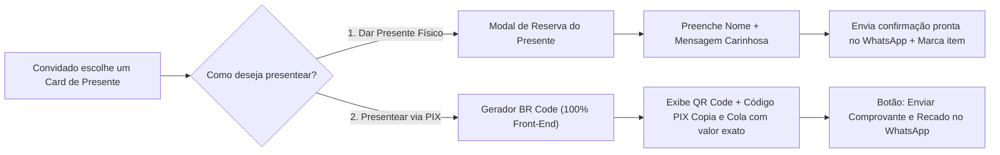

# Planejamento do Projeto: "De Repente 40!" — Experiência Imersiva & Lista de Presentes

Este documento detalha o que foi compreendido do seu pedido e a arquitetura técnica/visual para construir um site **feminino, moderno, elegante, 100% responsivo e gratuito**, com efeitos visuais cinematográficos guiados pelo scroll (*Scrollytelling*).

---

## 1. O que entendemos da sua referência de Efeitos Visuais ("Site do Avião")

Você mencionou aquele famoso site de efeitos visuais do avião (clássico efeito **Scrollytelling com GSAP ScrollTrigger + Parallax 3D**, onde o usuário rola a página e a cena ganha vida com elementos cruzando a tela em profundidade, textos surgindo de forma coreografada e seções que se transformam suavemente).

> [!IMPORTANT]
> **Como vamos aplicar essa tecnologia ao tema "De Repente 40!":**
> Em vez de um avião, quem guia a viagem conforme o convidado rola a tela são **elementos botânicos e festivos da arte original** (flores terracota e off-white, folhagens verde-oliva, pétalas flutuantes em 3D com desfoque de profundidade, notas musicais sutis e pinceladas orgânicas).

### Efeitos Visuais Planejados (HTML5 + CSS3 + GSAP + Lenis Smooth Scroll):
1. **Rolagem Ultra-Suave (Inércia / Smooth Scroll):** Uso da biblioteca *Lenis* combinada com *GSAP ScrollTrigger*, dando aquela sensação de "site premiado (Awwwards)" tanto no celular quanto no computador.
2. **Camadas de Profundidade (Parallax Multi-Layer & Pétalas 3D):**
   - Ao rolar a página, flores e ramos botânicos nas bordas se movem em velocidades diferentes (efeito de câmera em profundidade).
   - Um `<canvas>` leve renderiza pétalas e partículas douradas/terracota flutuando suavemente pela tela conforme a velocidade do scroll.
3. **Coreografia de Entrada (Storytelling em Etapas):**
   - **Ato 1 (Hero):** A frase *"Você está convidado(a) para comemorar comigo..."* aparece com efeito de escrita/revelação suave, seguida pelo impacto visual do **"De repente 40!"** que ganha escala e raios animados conforme o scroll.
   - **Ato 2 (A Festa):** Pinceladas em tom terracota (*brush strokes* em SVG) se desenham sozinhas na tela ao rolar, revelando *"Teremos uma deliciosa Feijoada e muito Pagode!"*, com notas musicais flutuando ao redor.
   - **Ato 3 (Data, Hora e Local):** Cards elegantes com efeito *Glassmorphism* (vidro fosco quente) mostrando **Dia: 03/04**, **Horário: 13h**, **Local: Espaço WM Prime** (com botão direto para abrir no Google Maps/Waze e contador regressivo ao vivo).
   - **Ato 4 (Lista de Presentes Interativa):** Cards com efeito **3D Tilt** (inclinam suavemente ao passar o mouse ou tocar) e filtros por categoria/faixa de valor.

---

## 2. Identidade Visual e Paleta de Cores (Baseada em `tema_e_layout.jpeg`)

Extraímos fielmente os códigos de cor e o estilo tipográfico da sua imagem `tema_e_layout.jpeg`:

| Elemento | Cor / Fonte | Código / Referência | Papel no Site |
| :--- | :--- | :--- | :--- |
| **Fundo Principal** | Creme Quente / Off-White | `#FDF3E7` / `#F7E6D2` | Fundo principal suave, aconchegante e feminino |
| **Cor de Destaque Primária** | Terracota Vibrante | `#C84B1C` / `#D35424` | Títulos ("40!"), pinceladas de destaque, botões principais |
| **Cor de Texto e Traços** | Marrom Café Profundo | `#5C220E` / `#4A1A0A` | Textos corridos, ícones finos, corações e assinaturas |
| **Detalhes Botânicos** | Verde Oliva & Creme Floral | `#6E7346` / `#8F9462` | Folhagens decorativas, selos de "Presente Escolhido", detalhes |
| **Tipografia Caligráfica** | Estilo *Handwritten / Script* | *Dancing Script* / *Great Vibes* / *Playfair Display Italic* | Títulos poéticos (*"De repente"*, *"Feijoada e Pagode"*) |
| **Tipografia Moderna** | Sans-Serif Arredondada & Elegante | *Plus Jakarta Sans* / *Outfit* | Cards de presentes, botões, valores e leitura rápida no celular |

---

## 3. Arquitetura Funcional dos Presentes e PIX (100% Gratuita e Segura)

### Como cada modalidade vai funcionar:
1. **Modalidade "Fazer o PIX do Presente" (Custo R$ 0,00):**
   - Motor próprio em JavaScript que gera o código oficial do Banco Central (**EMVCo BR Code** com cálculo de checksum `CRC16-CCITT`).
   - Gera na hora o **QR Code na tela** + botão **"Copiar Código PIX (Copia e Cola)"** já preenchido com o valor exato do presente (e teremos também um card de **"Cota Livre / Mimo de qualquer valor"**).
   - O convidado paga no app de qualquer banco e clica em *"Avisar a aniversariante no WhatsApp"*, que já abre a conversa com o recado e espaço para anexar o comprovante.

2. **Modalidade "Quero dar o Presente Físico":**
   - Mostra dicas do presente (ex: sugestão de cor/tamanho/estilo).
   - O convidado informa seu nome e clica em confirmar, abrindo o WhatsApp da aniversariante avisando qual item físico escolheu levar (e podemos conectar opcionalmente a uma planilha gratuita/Firebase para marcar o item como *"Já reservado"* na tela).

---

## 4. Estrutura de Arquivos do Projeto

Criaremos uma arquitetura limpa, rápida e pronta para hospedar gratuitamente no **GitHub Pages**, **Vercel** ou **Netlify**:

- `index.html` — Estrutura semântica completa, seções de Scrollytelling, galeria de presentes e modais de PIX/Presente Físico.
- `css/style.css` — Design System com variáveis das cores do convite, responsividade mobile-first, animações e layout dos cards.
- `js/pix.js` — Gerador seguro do payload PIX (Padrão Banco Central EMVCo + CRC16) e renderizador de QR Code no front-end.
- `js/gifts.js` — Catálogo configurável de presentes (fácil de editar nomes, fotos, preços e chave PIX em um único lugar) + integração com WhatsApp.
- `js/animations.js` — Motor de efeitos visuais (*GSAP ScrollTrigger*, *Lenis Smooth Scroll*, partículas botânicas flutuantes no Canvas e inclinação 3D dos cards).

---

## 5. Informações que você poderá personalizar facilmente (Configuração Rápida)

Deixaremos no topo do arquivo de configuração um bloco simples onde você pode ajustar a qualquer momento:
- **Nome da Aniversariante** (ex: Millena / Milleninha)
- **Chave PIX** (CPF, Celular, E-mail ou Chave Aleatória) + Nome e Cidade do titular
- **Número do WhatsApp** para receber os recados e confirmações de presentes
- **Lista de Presentes** (já vamos deixar uma lista completa, criativa e elegante pronta, que você pode alterar como quiser).

